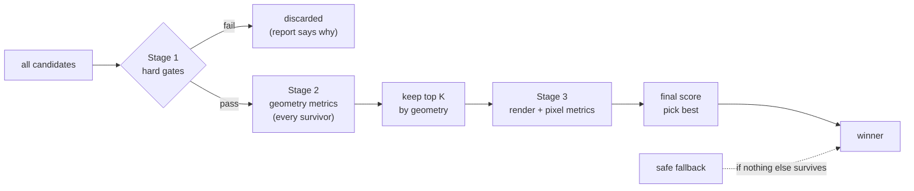

# Node 3: Grading

**Status:** ✅ built (plan Tasks 10–11, [PR #4](https://github.com/AngeloLandiza/Adobe-26-University-Hackathon/pull/4)). Code is in `chameleon/engine/pipeline/grading/`, plus `occlusion.py`. The design below still describes the approach; the list right after this section records where the code differs and pins the formulas the design only sketched.

## As built: differences from the design below

**Gates** (`gates.py`):
- `check_gates` never raises. Elements that fail G2 (schema) are skipped by the geometry gates.
- **G2** accepts a width or height of 0 where the source element already had 0 (the schema allows it, and the renderer draws a `line` shape with height 0). Before, one such divider made every candidate fail, so the fallback won every size. A size that collapses to 0 from a real size still fails, and so does a negative one.
- **G6** compares every non-editable field both ways, so an *added* field fails too.
- **G8** checks button labels (`container_label`) only. The rigid-group check isn't built; rigid placement preserves it by construction.
- **G9** uses cr-renderer's paint order: a stable sort by `z_index`, so at equal z the element listed later is on top. Covers are opaque images and shapes outside the background and decoration roles (`occlusion.py`, shared with node 2).

**Geometry metrics** (`metrics.py`): the weights are the starting values in §2.
- **hierarchy:** text against text by largest font, image against image by area. Text-vs-image pairs are skipped, since a hero image is normally bigger than the headline above it. Equal sizes count half.
- **legibility:** each unit's *smallest* text. From its floor to 1.6 × floor it scores 0.25 → 1; below the floor it scores up to 0.25, in proportion to size (`BELOW_FLOOR_SHARE`). The first version gave 0 to anything below the floor. On a canvas where no layout can meet the floors (Level 3 → 300×250), it couldn't tell 9 px text from 2 px, and the uniformly shrunk fallback won on faithfulness alone. Degradation still marks the floor itself.
- **overlap:** only the overlap fraction *beyond* what the same pair had in the source, so deliberate text-on-photo isn't penalised.
- **degradation:** a unit counts if node 2 flagged it **or any of its text is below its role's floor**. Before this change, the safe fallback scored 1.0 here and came within 0.015 of winning Level 3.
- **faithfulness:** the mean of (a) reading-order agreement with the source (centres within 0.1 × height count as one row) and (b) font-size order agreement.
- **space_use:** 1 inside the band [0.45, 0.85] of content bounding box ÷ canvas, falling linearly to 0 outside it.
- **alignment:** share of units sharing a left/centre/right or top/middle/bottom line with another, within 0.005 × the long side.
- **spacing:** ½ (units ≥ 0.02 × the short side from every edge) + ½ (1 − coefficient of variation of nearest-neighbour gaps).
- **balance:** 1 − (distance of the area-weighted centroid from the centre) ÷ (0.5 × √2).

**Pixel metrics** (`pixels.py`): one render per top-K candidate, with its text removed.
- **text_contrast:** the WCAG ratio between the alpha-composited text colour and the backdrop at **both** the 10th and 90th luminance percentile inside the box; the worse one counts. Light text is at risk from the light end, dark text from the dark end.
- **busyness:** 1 − mean(Sobel on 0–255 grey) ÷ 64.
- **placeholder:** 1 − the canvas share of missing-asset images, from geometry.

**Picking** (`score.py`):
- Only the top 6 by geometry are rendered and eligible.
- A candidate whose metrics or render fails is skipped or scores 0 on pixels; it never stops the pick.
- One report per candidate, in input order.

**Results:**
- Level 1 picks the reflow (0.973).
- Level 2 picks a row banner (0.904).
- Level 3 picks a strip banner (0.737, against the fallback's 0.607).

**Not built:** the VLM judge (§4) and weight calibration (§5).

**Job:** take every candidate from node 2, throw out the ones that break a rule, score the rest the way the official judge is likely to, and return the best one.

**Input:** `source`, `PriorityPlan`, `list[Candidate]`.
**Output:** the winning `Candidate`, plus a `GradeReport` per candidate ([README §4.3](README.md#43-gradereport-node-3-output-per-candidate)) for debugging and the finale add-on.
**Why it exists:** the official score comes from two checks, structural checks on the JSON and an AI judge looking at the rendered PNG (RULES, "What gets compared during scoring"). Node 3 is our local stand-in for both, so we only ever submit the candidate we'd have scored highest.

---

## 1. Hard gates (pass or fail)

These mirror what the official structural check is described as doing, plus the rules RULES states outright. Any failure discards the candidate. Gates use **tighter internal tolerances** than the official ones, to leave headroom.

| # | Gate | Check |
|---|---|---|
| G1 | ids | same set of element ids as the source, same count, no duplicates |
| G2 | schema | required fields per type present (as in `chameleon_design_schema_v0.9.json`); numbers finite; `width`, `height` > 0, or 0 where the source had 0; `font_size` ≥ 1 |
| G3 | canvas | `canvas` equals `target_canvas` |
| G4 | in canvas | every element's **rotated** bounding box inside `[0, W] × [0, H]`, with 0.5 px tolerance (same as `main.py`'s self-check) |
| G5 | image aspect | non-`cover` images: `|(w/h) / (w₀/h₀) − 1| ≤ 0.02` (the official limit is ~5%) |
| G6 | frozen fields | `content`, `font_family`, `font_weight`, `font_style`, `type`, `asset_id`, `fit`, `z_index`, `rotation`, `opacity`, colours and `style_runs` unchanged from the source |
| G7 | text fits | `TextMeasurer.fits()` for every text element. That checks the renderer's wrap; the measured block height (`(lines − 1) × font_size × line_height` + glyph height, as cr-renderer draws it) ≤ `height + 1 px`; every line's drawn width, including letter spacing, ≤ `width + 0.5 px`; and `max_lines` |
| G8 | groups intact | each label stays inside its shape; the members of a rigid group keep their relative layout within tolerance of a uniform scale |
| G9 | nothing hidden | no element is fully covered by a higher-`z` non-decoration element |

Every candidate's report lists its failed gates. When a non-fallback candidate fails, it points to a node 2 bug, and the debug output makes that visible.

## 2. Geometry metrics (every survivor, cheap)

Each metric is in `[0, 1]`, where 1 is best. Unit weights come from the plan: `w_u = 1 / rank^α`, with the same α as node 2. Background and decoration units are left out of every metric except `space_use`.

| Metric | What it rewards | How (sketch) | Start weight |
|---|---|---|---|
| `hierarchy` | more important units look more important | weighted Kendall-style agreement between rank and prominence. Prominence is box area for images; for text it's `font_size`, compared within text and by box area across types. | 0.20 |
| `legibility` | text big enough to read | per text unit: `0.25 + 0.75 × clamp((font − floor) / (comfort − floor))` at or above the floor, `0.25 × font / floor` below it, with `comfort = 1.6 × floor`, averaged by `w_u` | 0.20 |
| `overlap` | no accidental collisions | `1 −` normalised Σ overlap area between different content units, weighted by `w_a + w_b` | 0.15 |
| `degradation` | the important units got real slots | `1 − Σ w_u (degraded) / Σ w_u` | 0.10 |
| `faithfulness` | the source's intent survives | reading-order agreement with the source (top-to-bottom, left-to-right) for units that share a column or row; same font-size ordering among text | 0.08 |
| `space_use` | not empty, not cramped | content bounding-box coverage of the canvas vs a target band (≈ 0.45–0.85, per aspect class) | 0.08 |
| `alignment` | tidy edges | share of content units that share a left, centre or right (or top, middle, bottom) line with another unit, within 0.5% of the canvas | 0.07 |
| `spacing` | even rhythm and safe margins | content-to-edge distance ≥ margin; low spread of gaps within each row or stack | 0.07 |
| `balance` | visual weight not lopsided | distance of the area-weighted content centroid from the canvas centre. Low weight, because asymmetry can be good. | 0.05 |

`geometry_total = Σ weight × metric`. The starting weights sum to 1 and are **placeholders until calibration** (§5).

## 3. Pixel metrics (top K only)

The official judge looks at pixels, so we do too, but only for the top **K = 6** candidates by geometry, because rendering is the expensive step.

**Renders per candidate** go through `render_to_image()` in `engine/pipeline/render.py` (built), which renders through the vendored `render_design_to_png` and returns the pixels. The renderer only downscales, to `max_size` (default 1024) on the long side, so the pixel scale is `image width / canvas width`.

> **Stage-1 simplification:** each top-K candidate is rendered **once**, with its text elements removed, to see what's *behind* the text. Contrast and busyness come from that render. The `placeholder` metric is computed from geometry (missing-asset boxes) rather than from pixels. Full renders are only made for the debug contact sheet.

| Metric | How | Start weight (within pixel score) |
|---|---|---|
| `text_contrast` | per text element: WCAG contrast ratio between the text colour (alpha-composited) and the backdrop luminance inside its box, using a dark-end percentile so busy backdrops count. Score `min(1, ratio / 4.5)`, averaged by `w_u`. | 0.6 |
| `busyness` | mean gradient magnitude (Sobel) of the backdrop under each text box, normalised; calmer backgrounds score higher | 0.25 |
| `placeholder` | `1 −` the canvas fraction covered by missing-asset placeholders (the grey "missing asset" box the renderer draws) | 0.15 |

**Final score:** `total = 0.7 × geometry_total + 0.3 × pixel_total`, computed for the top K.

The weights are data, not constants: they come from `engine/pipeline/grading/weights.json` (or the file named by `CHAMELEON_GRADER_WEIGHTS`), and the defaults are the start weights in the tables above and a geometry share of 0.7. Each group must sum to 1 and `geometry_share` must be in [0, 1]. A missing file at the default path is silent; a missing env-var path, or an unreadable or invalid file, prints one `[distill]` line to stderr and the defaults are used.

- Only the top K can win.
- Ties are broken by `candidate_id` (deterministic).
- If no non-fallback candidate passed the gates, the safe fallback wins automatically.

## 4. Optional local VLM judge (off by default)

A small local vision model rates the top 3 renders against the rubric. Its score is blended in with a small weight. It's off for stage one because of CPU cost under emulation. We turn it on only if:

- calibration (§5) shows it agrees with the reference judge better than the deterministic score does, and
- the measured latency is acceptable.

---

## 5. Calibration (dev time only; nothing here ships in the image)

The weights above are guesses. We calibrate them against a reference judge that behaves like the official one.

1. **Judged set.** For each source × target in the dev matrix ([README §8](README.md#8-development-loop)), render the top ~8 candidates.
2. **Reference judge.**
   - Claude via the Anthropic Python SDK (`claude-opus-5-5`, already a dependency for node 1) gets the source render, two candidate renders and a rubric that mirrors the official one. It answers with structured outputs (`client.messages.parse()` / `output_config.format`): which candidate is better, per-criterion scores (legibility, hierarchy, faithfulness, layout quality) and a one-line reason.
   - Pairwise questions, asked in both orders, are more stable than absolute 1–10 scores.
   - Teammates make quick pairwise picks on a subset, to check the judge itself.
3. **Fit the weights.** Choose non-negative weights that maximise pairwise agreement between our `total` and the judge, e.g. logistic regression on metric differences or a coarse grid search. Keep them readable, with no metric weighted near zero without a reason.
4. **Track:**
   - held-out pairwise agreement;
   - how often our winner equals the judge's top pick.

   Re-run after any template or metric change. Don't tune on the 3 samples alone; they'll overfit.

When the full official rubric is published (open question 6 in the README), the rubric prompt and the metric list are updated to match it row for row.

## 6. Outputs

- `resize()` returns the winner's `design` only. `main.py` writes it and renders the official PNG.
- With `CHAMELEON_DEBUG=1`, write the following to `output/debug/<first 10 hex chars of sha1(source + target)>/`. `resize()` isn't told the task's file name, so the folder is keyed by content:
  - every `GradeReport`;
  - the top K renders as a labelled contact sheet;
  - the plan.
- **Finale add-on:** the top N reports plus their designs are exactly the "pick an option" list Angelo's doc describes.

## 7. Testing

- **Gates:** one deliberately broken fixture per gate, e.g. a duplicated id, a stretched image, an overflowing text box, a rotated element poking out of the canvas, a hidden element. Each must fail exactly its gate.
- **Metrics:** toy layouts with known answers. Two overlapping boxes score `overlap` < 1; a headline smaller than the legal text scores low on `hierarchy`; white text on a white backdrop scores low on `text_contrast`.
- **Determinism:** the same task twice gives the same winner and identical output JSON.
- **Regression snapshots:** store the winning `candidate_id` per dev-matrix cell, and review the diffs whenever node 2 or node 3 changes.
