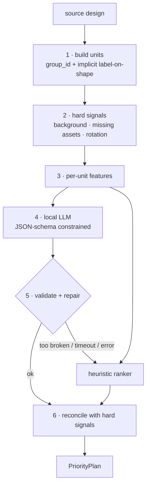

# Node 1: Priority (LLM)

**Job:** turn a design with no labels into a `PriorityPlan`. That means grouping elements into units, giving each unit a role, and ranking the content units from most to least important.

**Input:** `source` (`{"canvas", "elements"}`) and the assets directory (only to check whether each `asset_id` file exists).
**Output:** `PriorityPlan` ([README §4.1](README.md#41-priorityplan-node-1--node-2-node-3)).
**Never raises.** If the LLM path fails in any way, the heuristic ranker produces the plan.



---

## 1. Build units (deterministic)

A **unit** is something the layout moves as one piece.

- **Explicit groups.** All elements that share a non-null `group_id` form one unit, with `unit_id = group_id`.
- **Implicit label-on-shape.** A text element with no group whose box sits ≥ 90% inside a `shape` element's box, painted above it (higher `z_index`), joins that shape as a `container_label` unit. Sources won't always set `group_id` on buttons.
- **Everything else** is a `single` unit with `unit_id = element id`.

`kind` tells node 2 how to resize the unit:

- `single`: one element.
- `container_label`: one shape plus the text inside it, e.g. a button or badge pill. Resized as a box, with the label re-fitted inside.
- `group`: any other multi-element group. Resized rigidly.

Every element lands in exactly one unit. This is asserted, not assumed.

## 2. Hard signals (deterministic, the LLM can't override them)

| Signal | Rule | Effect |
|---|---|---|
| Background | an `image` (or a `shape`) covering ≥ 90% of the canvas, with the lowest `z_index` among elements it overlaps | goes to `background_unit_ids`; not ranked |
| Missing asset | `image` whose `asset_id` file isn't in `brand_kit/assets/` | flag `missing_asset`; forced to the bottom of the ranking. The renderer draws a grey placeholder box, so the smaller it ends up the better. |
| Rotated | any member with `rotation != 0` | flag `rotated`; node 2 keeps the angle and uses rotated bounds |

## 3. Features (shared by the LLM prompt and the heuristic)

Per unit, compact and normalised to the source canvas (0–1):

- **identity:** `unit_id`, `kind`, member types
- **geometry:** `bbox` (x, y, w, h normalised), `area_pct`, `center`, `aspect`, `z_index`, `opacity`, `rotation`, `is_full_canvas`
- **text members:** `content` (first ~160 chars plus total length), `font_size`, `font_size_rank` among all text (1 = largest), `bold`, `italic`, `all_caps`, `word_count`, text colour alpha
- **image members:** `asset_id` filename, `fit`, `missing_asset`
- **shape members:** `shape_type`, fill alpha, `has_label`, `corner_radius > 0`
- **relations:** ids of units it overlaps (top 3 by overlap area), whether it lies inside another unit

Filenames like `solstice_logo_lockup.png` are useful hints, but hidden tasks may not have meaningful names. Neither the LLM prompt nor the heuristic may *depend* on them.

## 4. The LLM call

### Runtime

- **Engine:** `llama-cpp-python` on CPU, GGUF weights baked into the image at build time. Load once per process (module-level cache), because `main.py` runs all tasks in one process.
- **Model:** a small instruct model, 1.5–4B parameters, Q4_K_M quantisation. Pick it by a **bake-off on our golden set** (§7), not by reputation. Candidates: current Qwen small instruct models, Llama 3.2 3B Instruct, Gemma 2B-class, Phi mini-class. **Check that the licence allows redistribution inside a Docker image.**
- **Decoding:** temperature 0, fixed seed, `max_tokens` ≈ 600, output constrained to the JSON schema below (llama.cpp grammar / JSON-schema mode), so the output is always parseable.
- **Time limit:** a wall-clock budget per call (start at 120 s, configurable). If it's exceeded we stop generating and fall back to the heuristic. Latency under amd64 emulation on the reference Mac is unknown, so **measure it in Docker as the very first spike.**

### Prompt

System prompt (fixed, cache-friendly):

- what the input is: units from a marketing graphic, described by geometry and content;
- the role definitions (table below), one line each;
- what "important" means: the core message, what's being sold, how to act on it, and who it's from come first; supporting copy next; promo badges, secondary images, fine print and decoration last;
- output instructions: a short `summary`, a role per unit, then a full ranking of content units.

User message: the features list (§3) as compact JSON. Background units are left out. They're listed separately so the model knows they exist but doesn't rank them.

Optionally, one short worked example (a few-shot) if the bake-off shows small models need it. Keep the whole prompt under ~2k tokens; prompt length dominates CPU latency.

### Output schema

Built per request: `unit_id` is an enum of this design's unit ids, so the model *can't* invent ids.

```json
{
  "summary": "Ad for Solstice sparkling botanical drink; new flavour; push to shop the summer line.",
  "roles": [
    { "unit_id": "headline", "role": "headline" },
    { "unit_id": "cta",      "role": "cta" },
    { "unit_id": "deco_circle_1", "role": "decoration" }
  ],
  "ranking": ["headline", "product", "cta", "logo", "subhead", "badge"]
}
```

`summary` (≤ 30 words) is a cheap "think first" step for small models. It isn't used downstream, apart from debug output.

## 5. Validate and repair

1. Every unit gets exactly one role. A missing or invalid role gets the heuristic's role.
2. `ranking` contains every *content* unit exactly once:
   - duplicates are dropped, keeping the first occurrence;
   - units with role `background` or `decoration` are moved out of the ranking;
   - missing content units are inserted where the heuristic would place them relative to their neighbours.
3. **Give up on the LLM output** if more than ~30% of units needed repair. That means the model is confused, so use the heuristic plan wholesale rather than a patchwork.

## 6. Reconcile with hard signals

- Background units stay background whatever the LLM said.
- `missing_asset` units move to the end of the ranking.
- Ranks are renumbered to a strict `1..n`.
- `source` is set to `"llm"` or `"heuristic"` so node 3 and debug output know which path ran.

---

## Roles

This table is the contract between node 1 and node 2. Node 2's default treatment per role is detailed in [02-resize-engine.md](02-resize-engine.md).

| Role | Meaning | Engine treatment (summary) |
|---|---|---|
| `background` | full-bleed image or shape behind everything | cover-fill the whole target canvas |
| `decoration` | non-informational shapes and flourishes (e.g. faint circles) | uniform scale, anchored to the nearest corner or edge; may shrink a lot |
| `headline` | the main message | largest text slot |
| `subheadline` | supporting copy | stacks with the headline; first text to shrink |
| `cta` | call to action, as a button or plain text | always gets its own slot; high minimum size |
| `logo` | brand mark | small slot at an edge or top of a stack; aspect locked |
| `hero_image` | product or main visual | largest image slot |
| `badge` | short promo label or ribbon ("NEW FLAVOR", "SUNSET SALE") | clustered with other badges; corner or row |
| `secondary_image` | any other image, including watermarks and missing assets | small, at an edge |
| `legal` | fine print, disclaimers | single line or strip along an edge, at the readability floor |
| `other_text` | anything else | like `subheadline`, lower down the ranking |

## Heuristic ranker (fallback and baseline)

Deterministic rules over the same features. It's both the fallback and **the baseline the LLM has to beat** (§7).

**Roles:**

1. Hard signals first (background).
2. A `shape`-only unit with no label → `decoration`.
3. A `container_label` unit, or a rotated group:
   - label starts with an action verb (shop, buy, get, order, try, learn, discover, sign up, book, start...) → `cta`;
   - otherwise short or all-caps text, or rotated → `badge`.
4. `image` units:
   - small (< 6% of area), wide, near an edge → `logo`;
   - the largest remaining image → `hero_image`;
   - the rest, and missing assets → `secondary_image`.
5. `text` units:
   - largest `font_size` (bold breaks ties) → `headline`;
   - smallest font with long text near the bottom, or text containing legal markers ("responsibly", "terms", "©", "rights reserved", "void where") → `legal`;
   - short standalone action-verb text → `cta` (Level 1's plain-text CTA);
   - the rest → `subheadline` if its font is ≥ 50% of the headline's, otherwise `other_text`.

**Ranking:** order by role priority:

`headline` › `hero_image` › `cta` › `logo` › `subheadline` › `badge` › `secondary_image` › `other_text` › `legal`

Ties are broken by prominence (area for images, font size × text length for text), then by reading order (top-to-bottom, left-to-right).

## 7. Testing and model selection

- **Golden labels.**
  - The team hand-labels roles and rankings for the 3 samples plus every dev design in `input/`.
  - Claude (`claude-opus-5-5`, structured outputs) can draft labels for new dev designs, which a teammate reviews before they become golden. This is dev time only ([README §8](README.md#8-development-loop)).
- **Metrics:**
  - role accuracy;
  - Kendall τ between the predicted and golden ranking;
  - **top-3 recall**: golden top-3 units all within the predicted top 4. This matters most, because it decides what gets space.
- **Bake-off.** Run the heuristic and each candidate model on the golden set, recording the metrics and **latency inside the Docker image**. Ship the LLM only if it clearly beats the heuristic. If it doesn't, the heuristic is node 1, and the LLM path stays behind a flag until it earns its place.
- **Unit tests:**
  - unit building (explicit and implicit groups, every element in exactly one unit);
  - hard-signal overrides;
  - repair logic (feed it broken LLM outputs);
  - the time-limit fallback.

## 8. Upgrade paths (after stage one works)

- **See the design.** Render the source with the official renderer and give a small local VLM the image plus the features. It can see that an image is a bottle or a logo without relying on filenames. Costs more CPU time.
- **Fine-tune.** LoRA on Claude-labelled, team-reviewed data. Per RULES, the adapter must be published (public Hugging Face repo).
- **Target-aware hints.** Ask which units *must* stay readable for this specific target, as a hint to node 2 for extreme formats like 728×90.
