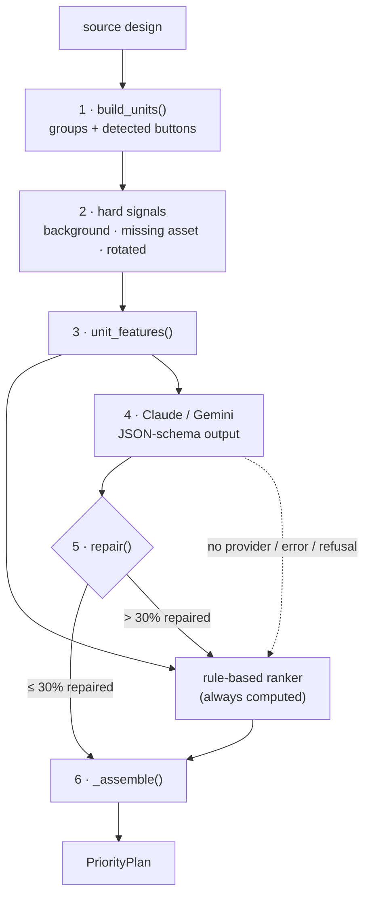

# Node 1: Priority

**Status:** ✅ built (plan Tasks 3–6, [PR #4](https://github.com/AngeloLandiza/Adobe-26-University-Hackathon/pull/4)). Code is in `chameleon/engine/pipeline/priority/`.

**Job:** turn a design with no labels into a `PriorityPlan`. That means grouping elements into units, giving each unit a role, and ranking the content units from most to least important.

**Input:** `source` (`{"canvas", "elements"}`) and the assets directory, used only to check whether each `asset_id` file exists.
**Output:** `PriorityPlan` ([README §4.1](README.md#41-priorityplan-node-1--node-2-node-3)).
**Entry point:** `plan(source, assets_dir="brand_kit/assets", provider=None)`. It **never raises**: if the LLM path fails in any way, the rule-based ranker produces the plan, and `stats.error` says why.



---

## 1. Build units (`units.py`)

A **unit** is something the layout moves as one piece.

- **Explicit groups.** All elements that share a non-null `group_id` form one unit, with `unit_id = group_id`.
  - If that id is also the id of an element *outside* the group, the unit becomes `<group_id>#group`, so two units can never share an id.
- **Detected buttons (implicit label-on-shape).** An ungrouped text joins an ungrouped shape as a `container_label` unit when:
  - the text box is ≥ 90% inside the shape box, and the text is painted above it (higher `z_index`);
  - it's the **only** text that qualifies for that shape;
  - the text box covers **≥ 25% of the shape's area**.

  If a text sits on several shapes, the smallest one wins. The last two conditions keep a backdrop panel behind several lines of copy (or one small line) from being mistaken for a button; the sample buttons' labels cover 49–63% of their shapes. The unit id is the shape's id.
- **Everything else** is a `single` unit with `unit_id` = the element id.

`kind` tells node 2 how to resize the unit:

- `single`: one element.
- `container_label`: one shape plus the text on it, e.g. a button or badge pill. An explicit group gets this kind when it's exactly one shape + one text with the text ≥ 90% inside. It's resized as a box, with the label re-fitted inside.
- `group`: any other multi-element group, resized rigidly.

Units are listed in the order their first member appears in the source. Every element lands in exactly one unit; a test asserts this on all samples.

## 2. Hard signals (decided by code, never by the LLM)

| Signal | Rule | Effect |
|---|---|---|
| Background | a `single` image or shape that covers ≥ 90% of the canvas (on-canvas part) and has a `z_index` ≤ every element it overlaps | flag `background` and role `background`. Never ranked; node 2 cover-fills it. A full-canvas tint stacked *above* the background is not a background. |
| Missing asset | an image whose `asset_id` file isn't in the assets folder (checked with the renderer's own `asset_path`) | flag `missing_asset`; always ranked last. The renderer draws a grey placeholder box, so the smaller it ends up the better. |
| Rotated | any member with a non-zero `rotation` | flag `rotated`; node 2 keeps the angle and uses rotated bounds. |

## 3. Features (`features.py`)

`unit_features(source, units)` returns one dict per unit, in unit order. The LLM prompt and the rule-based ranker read the same features. Positions are fractions of the source canvas; `aspect` is in pixels. A unit's missing attributes (e.g. text features of an image) are `None`.

| Group | Keys |
|---|---|
| identity | `unit_id`, `kind`, `flags`, `types` (member types in order) |
| geometry | `bbox` `[x, y, w, h]`, `area_pct` (on-canvas part only), `aspect` (px width / height), `center` `[cx, cy]`, `z_index`, `opacity`, `rotation`, `is_full_canvas` (`area_pct` ≥ 0.9) |
| text | `text` (first 160 chars), `text_len`, `font_size`, `font_size_rank` (1 = largest; equal sizes share a rank), `bold`, `all_caps`, `word_count` |
| image | `asset_id`, `fit`, `missing_asset` |
| shape | `shape_type`, `has_label` |
| relations | `overlaps`: up to 3 other units by overlap area, largest first. Background units are left out, since everything overlaps them. |

**Multi-element units** combine their members:
- geometry comes from the combined box of all members;
- `z_index` and `opacity` are the highest of the members;
- `rotation` is the first non-zero one;
- `text` joins the member texts with spaces;
- `font_size` is the largest member font.

File names like `solstice_logo_lockup.png` are useful hints, but hidden tasks may not have meaningful names. Neither the prompt nor the rules depend on them.

## 4. The LLM call (`prompt.py`, `providers.py`)

### Providers

Both providers expose `complete(system, user, schema) -> LLMResult(data, stats)`, receive identical inputs (which keeps the benchmark fair), and create their SDK client lazily, so constructing one never needs a key.

| | Claude (`ClaudeProvider`) | Gemini (`GeminiProvider`) |
|---|---|---|
| Default model | `claude-opus-5-5` (`CHAMELEON_CLAUDE_MODEL` overrides) | `gemini-3.8-flash` (`CHAMELEON_GEMINI_MODEL` overrides) |
| Call | `client.beta.messages.create`, `max_tokens` 4096, `output_config` with effort `low` and a JSON schema format | `client.models.generate_content` with `system_instruction`, `response_mime_type="application/json"` and `response_json_schema` |
| Refusals | server-side fallback on (`fallbacks="default"`, beta `server-side-fallback-2026-07-01`). A refusal that still comes back raises `ProviderError`. | blocked or empty answers fail JSON parsing and raise `ProviderError` |
| Notes | no `temperature` (Opus 5.5 rejects it); reads the first text block, since a thinking block comes first | thinking tokens are counted as output for cost |
| Client | timeout 60 s, 1 retry | timeout 60 s (`HttpOptions.timeout` is in milliseconds) |

A cut-off answer (`max_tokens`) or non-JSON also raises `ProviderError`. Other SDK errors (auth, network, timeouts) propagate; `plan()` catches all of them.

**Choosing a provider:** `get_provider(name)`. `name` falls back to env `CHAMELEON_LLM`, then to `auto`:
- `auto` uses Claude if `ANTHROPIC_API_KEY` is set, Gemini if `GEMINI_API_KEY` or `GOOGLE_API_KEY` is set, and the heuristic otherwise;
- `claude` and `gemini` force a provider; `heuristic` means none;
- an unknown name raises `ValueError`, which `plan()` turns into a heuristic plan with the error recorded.

**Cost** is computed from `pricing.py` (USD per million tokens, as of 2026-10-13). An unlisted model reports `NaN` rather than a misleading $0.

**Response cache:** when `CHAMELEON_LLM_CACHE` names a directory, `cached_complete()` stores each successful answer, keyed by provider, model, prompt and schema. A hit reports cost 0 and latency 0, but keeps the original token counts. Failures are never cached.

### Prompt

- **System prompt** (fixed): what the units are and what's known about them, one line per role, how to rank, and "write a ≤ 30-word summary first" (a cheap think-first step). The ranking guidance: the core message, what's being sold, how to act on it, and who it's from come first; supporting copy next; badges, secondary images and fine print last. On a very small format, what a viewer must not miss goes first.
- **User message:** the features of every non-background unit, plus `background_unit_ids`. It's compact JSON with sorted keys and floats rounded to 3 places, so identical designs produce identical prompts and the prompt stays short.

### Response schema

`response_schema(unit_ids)` is built per design. `unit_id` is an enum of *this* design's unit ids, so the model can't invent one, and `role` is an enum of the roles below. Every object has `additionalProperties: false`.

```json
{
  "summary": "Ad for Solstice sparkling botanical drink; new flavour; push to shop the summer line.",
  "roles": [
    { "unit_id": "headline", "role": "headline" },
    { "unit_id": "cta",      "role": "cta" },
    { "unit_id": "deco_circle_1", "role": "decoration" }
  ],
  "ranking": ["headline", "product", "cta", "logo", "subhead", "badge"]
}
```

`summary` isn't used downstream.

## 5. Validate and repair (`validate.py`)

`repair(raw, units, heur_roles, heur_ranking)` returns `(roles, ranking, repaired_fraction)`:

1. **Roles.**
   - The first valid role per unit wins; a later duplicate counts as a fix.
   - A missing or invalid role gets the heuristic's role and counts as a fix.
   - Ids the design doesn't have are dropped without counting.
2. **Background is a hard signal.**
   - Background units always stay background, and the LLM may skip them (the prompt only lists them by id), so that isn't a fix.
   - The LLM may **not** label any other unit `background`: node 2 would stretch it over the whole canvas. That label is treated as invalid.
3. **Ranking.**
   - Unknown ids are dropped.
   - Duplicates, and units whose role is `background` or `decoration`, are removed and count as fixes.
   - Each missing content unit is inserted right after the nearest unit that precedes it in the heuristic's ranking, or at the front if there's none.
4. **Fraction:** the number of units involved in any fix ÷ the number of units.

`plan()` **gives up on the LLM answer** if more than 30% of units needed fixing (`MAX_REPAIR_FRACTION`). It uses the heuristic plan wholesale and sets `stats.error = "too_many_repairs"`.

## 6. Assemble the plan (`_assemble`)

- It returns new `Unit` copies and never changes the units passed in, so a fallback can't inherit half an LLM answer.
- Background units keep role `background` whatever the roles say.
- Content units the ranking left out are appended; `missing_asset` units move to the end; ranks are renumbered `1..n`.
- `source` is `"llm"` or `"heuristic"`.

`plan()` also never raises on a design it can't analyse (e.g. elements missing coordinates). It returns one plain unranked unit per element, with `stats.error` set.

---

## Roles

This table is the contract between node 1 and node 2. Node 2's treatment per role is detailed in [02-resize-engine.md](02-resize-engine.md).

| Role | Meaning | Engine treatment (summary) |
|---|---|---|
| `background` | full-bleed image or shape behind everything (hard signal only) | cover-fill the whole target canvas |
| `decoration` | non-informational shapes and flourishes (e.g. faint circles) | uniform scale, anchored to the nearest corner or edge; may shrink a lot |
| `headline` | the main message | largest text slot |
| `subheadline` | supporting copy | stacks with the headline; first text to shrink |
| `cta` | call to action, as a button or plain text | always gets its own slot; high minimum size |
| `logo` | brand mark | small slot at an edge or top of a stack; aspect locked |
| `hero_image` | product or main visual | largest image slot |
| `badge` | short promo label or ribbon ("NEW FLAVOR", "SUNSET SALE") | clustered with other badges; corner or row |
| `secondary_image` | any other image, including watermarks and missing assets | small, at an edge |
| `legal` | fine print, disclaimers | single line or strip along an edge, at the readability floor |
| `other_text` | anything else | like `subheadline`, lower down the ranking |

## Rule-based ranker (`heuristic.py`)

Deterministic rules over the same features. It's both the fallback and **the baseline the LLM has to beat** (§7). On the three samples it gets every role right and the top 3 right.

**Roles,** applied in this order:

1. A `background` flag → `background`.
2. A unit made only of shapes → `decoration`.
3. A `container_label`, or a rotated `group`:
   - its text's first word is an action verb (shop, buy, get, order, try, learn, discover, sign, book, start, explore, join, download, subscribe, save, claim; case and punctuation ignored) → `cta`;
   - otherwise → `badge`.
4. **Image units** (all members are images):
   - a missing asset → `secondary_image`;
   - among images under 6% of the canvas, with aspect ≥ 1.5 and centre within 20% of an edge, the one with the highest `z_index` (largest on ties) → `logo`;
   - the largest remaining image → `hero_image`; the rest → `secondary_image`.
5. **Text units** (singles, plus generic groups that carry text, such as an icon with a caption):
   - the single text with the largest font (bold breaks ties) → `headline`. Only single texts can be the headline;
   - text containing a legal marker ("responsibly", "terms", "©", "rights reserved", "void where", "conditions apply") → `legal`. The marker is matched on the 160-character preview;
   - the smallest-font remaining text, if it has more than 12 words and sits in the bottom 20% → `legal`;
   - text of ≤ 6 words starting with an action verb → `cta` (Level 1's plain-text CTA);
   - of what's left: the largest font → `subheadline`; others with a font ≥ 50% of the headline's → `subheadline`; the rest → `other_text`.
6. Anything no rule names (e.g. an image + shape group) → `secondary_image`.

**Ranking:** content units by role order:

`headline` › `hero_image` › `cta` › `logo` › `subheadline` › `badge` › `secondary_image` › `other_text` › `legal`

Within a role, units are ordered by prominence (`font_size × text length` for anything with text, area otherwise), then reading order (top to bottom, left to right), then unit id. Missing-asset units are moved to the very end when the plan is assembled.

## 7. Testing and model selection

- **Tests** (`chameleon/tests/`): `test_units.py`, `test_heuristic.py`, `test_providers.py` and `test_plan.py` cover unit building, hard signals, features, every role rule, the provider request shapes and error handling, repair, fallbacks and the cache.
  - Both SDKs are also exercised for real against canned API responses, with only the network replaced.
  - Each important rule was broken on purpose, to confirm a test catches it.
- **Live API tests** (`-m live`) haven't been run yet: no keys were available while building. Still to confirm with a keyed run:
  - Claude's API accepting the schema's enums under structured output;
  - Gemini accepting `additionalProperties: false`;
  - real latency and cost.

  If either API rejects the schema, `plan()` falls back to the heuristic.
- **Golden labels:** `chameleon/dev/golden/*.json` hand-label roles and rankings for the 3 samples. **They're team judgements; please review them.** Add one for every new dev design. Claude can draft labels, but a teammate reviews them before they count.
- **Metrics** (`chameleon/dev/priority_metrics.py`):
  - role accuracy;
  - Kendall τ between the predicted and golden ranking;
  - **top-3 recall**: the golden top 3 all within the predicted top 4. This matters most, because it decides what gets space.
- **Benchmark** (plan Task 14): heuristic vs each provider and model on the golden set, recording quality, latency and cost. The LLM path only earns a place in a scored run if it clearly beats the heuristic; the threshold and next steps are in the plan's "Decision point after Task 14".

## 8. Upgrade paths

- **Local model in the image.** A small open-weights model (1.5–4B, quantised, llama.cpp on CPU) would let the LLM path work under `--network none`. Only worth building if the benchmark shows the LLM clearly wins. Check the licence allows redistribution, and measure latency inside Docker on the reference hardware.
- **See the design.** Render the source with the official renderer and give a vision model the image plus the features, so it can tell a bottle from a logo without relying on file names.
- **Fine-tune.** LoRA on reviewed labels. Per RULES, the adapter must be published (public Hugging Face repo).
- **Target-aware hints.** Ask which units *must* stay readable for this specific target, as a hint to node 2 for extreme formats like 728×90.
