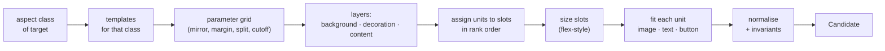

# Node 2: Resize engine

**Status:** ✅ built (plan Tasks 7–9, [PR #4](https://github.com/AngeloLandiza/Adobe-26-University-Hackathon/pull/4)). Code is in `chameleon/engine/pipeline/layout/`. The design below still describes the approach; the list right after this section records where the code differs, and wins where they disagree.

## As built: differences from the design below

**Placement** (`place.py`):
- Rotated units are fitted by the union of their members' **rotated** outlines. A rotated single element shrinks until its rotated bounds fit the slot.
- Units with text never scale past **1.5×** (`MAX_TEXT_GROWTH`).
- A re-fitted label keeps its visual centre where the source had it.
- Text fitting re-checks with letter spacing scaled to the chosen size.
- `place_unit` takes **`max_font`**: minor and leftover units are capped at their role's floor size, so they stay small however much room they get.
- **Images have a hard floor too** (Task 15): `place_unit` returns `None` when an image would end up under 6 px (`HARD_FLOOR`) on its short side. An image whose source is thinner than that keeps its own thickness. Callers then treat the image like text that doesn't fit, and it moves on to the free-space pass. Without this, the minor-zone flow handed the Level 3 watermark a sliver of leftover room, and it came out 0.04 × 0.02 px in the Linux container and 1.6 × 0.7 px on Windows.
- **Condensed pills** (§5.4):
  - compress vertically to fit short slots, down to the label plus 0.2 × font of padding above and below;
  - also work for **rotated** pills, checking their rotated bounds.

**Templates and assignment** (`templates.py`, `generate.py`):
- Fixed fractional slots, as planned. Slots carry an `align`; in strips the logo aligns to the **top**, so the space it leaves forms one usable block.
- Logos never grow past 1.5× their source size (§3.5).
- Text roles never cluster into a row; only other same-role consecutive units do.
- **A crowded row wraps:** if some units in a row can't reach their floor in one line, the row wraps onto as few lines as lets every unit reach it. At 1080×1920, Level 3's four badges share a 464×177 slot; in one line each pill got 116 px and its label 6–8.5 px against a 16.2 px floor, and on two lines they stay at their floor.
- **Text stacks** give each unit the height it needs at its role's floor. While they don't all fit, the lowest-ranked units drop to the 6 px hard floor, then out to the free-space pass. Spare height is shared by priority weight.
- **The minor zone flows** units left to right at their natural width, instead of equal cells.
- **Free space** (§4 step 5): a coarse occupancy grid, scanned for the largest *distinct* empty rectangles (any rectangle inside a kept one is dropped). Leftovers are placed **biggest footprint first** (their smallest form at the hard floor). Leftover images are capped at a third of the canvas each way.
- **Decorations** that would be fully covered by content try the other corners (`place_decoration(..., corner=)`), so gate G9 never discards a layout over a hidden circle.
- **Backdrops** (after the whole-branch review): a decoration shape that the source paints text on, such as a panel behind copy or a card under a headline, follows that text instead of going to a corner. Its new box is the text's new *drawn* bounds (widest line per `text_align`, measured block), plus the source padding scaled with the font. If that would overlap content painted below it, it tries again with no padding, and only then is it parked like other decorations.
- **Leftovers that fit nowhere at the 6 px hard floor try 4, 2 and 1 px** (`LEFTOVER_FLOORS`) before a template is dropped. Before this, a dense design in a small banner lost every template and returned the fallback with all text at about 1 px.
- **If the leftover pass still fails, it's redone once in rank order.** Leftovers normally go biggest footprint first, so a long, low-priority subhead or legal text could fill every gap before the CTA got one. On Linux, Level 3's CTA pill misses its 320×50 slot (85.6 px at 6 px against 69.5 px), so this happened in every template. The retry lets the important units claim room first. Level 3 at 300×50 and 320×50 now gets real layouts on both platforms, with the CTA never smaller than the subhead or legal text.
- *Tried and reverted:* sizing text boxes to their drawn text. It didn't free the space that mattered, and because the grader measures alignment on boxes, it moved six matrix winners.
- **Reflow** doesn't push units apart. Proportional centre mapping with sizes scaled by s = min(W/Ws, H/Hs) can't create overlaps the source didn't have; a test checks this on every sample × target.
- **Reflow text scales with the layout** (after the whole-branch review): it's capped at s × its source size (never below the role's floor), and each unit sits at the top of its scaled box, where the renderer draws text. Before, text filled its box up to 1.5× the source size, so a half-size reflow had text 1.3–2.4× too big.
- **A target within 2% of the source's aspect gets only the reflow** (`SAME_ASPECT_TOL`), with templates only if the reflow fails. A 1080×1080 design resized to 1080×1080 comes back as itself; before, Level 2 was rebuilt as a stack.
- One template variant failing to build is skipped, never fatal.

**Finalising and the fallback** (`normalize.py`, `layers.py`, `fallback.py`):
- `finalize` rounds box sizes **up** and font size and letter spacing **down**, so rounding can never re-wrap text. A non-cover image's height is then derived from its rounded width, so a sub-pixel image (0.375 × 0.1125) can't drift off its aspect.
- A non-cover background image keeps its aspect: it's fitted inside the canvas, not stretched.
- The safe fallback pulls bleeding elements in **one unit at a time** (a button and its label move together), and re-fits text that overflows its box. If even 1 px overflows, the box grows to the measured text and is pulled back onto the canvas.
- The **last resort** in `resize.py` (used only if the fallback itself fails) scales the whole source uniformly and centres it, so it can't stretch an image either.

**Results** (dev matrix, 3 samples × 13 sizes, after the whole-branch review fixes):
- Every generated candidate passes every gate, on Windows and in the Linux container.
- Level 3 → 728×90 builds 36 real layouts (12 before the sub-floor leftovers, none before Task 9).
- Real layouts win all 39 cells, on Windows and in the Linux container (what scoring runs). Level 3 → 300×250 picked the fallback until legibility was graded below the floor (see [03](03-grading-node.md), "As built").

**Known gaps** (see [README §11](README.md#11-whats-missing-as-of-2026-10-17)):
- short text CTAs wrap one word per line in narrow columns;
- the missing-asset placeholder can be prominent;
- a multi-shape decoration group is placed per element;
- a zero-height line divider is a decoration, so it goes to a corner instead of staying between the texts it separated.

**Job:** given the source design, the target canvas and the `PriorityPlan`, generate many valid candidate layouts. Important units get space first; minor units get what's left. Node 2 doesn't pick a winner. That's node 3's job.

**Input:** `source`, `target_canvas`, `PriorityPlan`.
**Output:** `list[Candidate]` ([README §4.2](README.md#42-candidate-node-2--node-3)). The **safe fallback** candidate is always included and always valid.
**Design rule:** build valid by construction. Gate failures in node 3 should mean a bug or a genuinely impossible fit, not routine sloppiness.



---

## 1. Aspect classes

`r = target width / target height`. The class decides which templates run. Thresholds are tunable.

| Class | r | Real formats | Samples |
|---|---|---|---|
| `very_tall` | < 0.55 | story 1080×1920 (0.56, borderline), wide skyscraper 160×600 (0.27) | |
| `tall` | 0.55 – 0.85 | portrait 1080×1350 (0.8) | Level 1 target |
| `square` | 0.85 – 1.25 | post 1080×1080, medium rectangle 300×250 (1.2) | |
| `landscape` | 1.25 – 2.2 | YouTube thumbnail 1280×720 (1.78) | |
| `wide` | 2.2 – 5 | Facebook cover 820×312 (2.6), billboard 970×250 (3.9), LinkedIn 1584×396 (4.0) | Level 2 target |
| `strip` | > 5 | leaderboard 728×90 (8.1) | Level 3 target |

The **proportional reflow** template (§3.6) runs for every class. It wins when the target shape is close to the source shape, and the grader sinks it when it isn't.

## 2. Layers

Each candidate is built in three layers. `z_index` is never changed, so the painting order is always the source's.

1. **Background** (`background_unit_ids`): `x=0, y=0, width=W, height=H`. `fit: cover` crops as allowed. Shape backgrounds are treated the same way.
2. **Decoration** (`decoration_unit_ids`):
   - uniform scale by `s = min(W/Ws, H/Hs)`, so circles stay circles;
   - placed at the same relative offset from the source's nearest corner or edge, offset scaled by `s`;
   - clamped fully inside the canvas until open question 1 (bleed) is answered.

   Overlapping content is fine. It's intentional layering, and node 3 doesn't count it as a collision.
3. **Content**: every ranked unit, laid out by a template.

## 3. Templates

A template is a small **slot tree**: rows and columns of slots, where each slot lists the roles it accepts (in preference order), its alignment, and whether it can hold a *cluster* (several units of the same role, e.g. three badges in a row). **Every template has a `minor` zone** where units that didn't get a proper slot end up.

The sketches below show intent, not exact proportions.

### 3.1 `strip` (e.g. 728×90)

```
┌────────────────────────────────────────────────────────────────────────┐
│ [logo] │ [hero] │ HEADLINE (1–3 lines)                     │ [  CTA  ] │
│        │        │ minor: badges · subheadline · legal       │           │
└────────────────────────────────────────────────────────────────────────┘
```

Variants: hero left or right of the text; logo next to the CTA instead of first; minor line on or off (off means minor units go to the free-space pass, §4.3).

### 3.2 `wide` (e.g. 1600×400)

```
┌──────────────────────────────────────────────────────────────────┐
│ (badge)                                                          │
│   [ hero  ]    logo                                              │
│   [ image ]    HEADLINE                            [   CTA   ]   │
│   [       ]    subheadline                                       │
│                                                minor / legal     │
└──────────────────────────────────────────────────────────────────┘
```

Variants: mirrored; CTA in its own right-hand column, or under the text stack.

### 3.3 `landscape` (e.g. 1280×720)

```
┌──────────────────────────────────────┐
│ logo                         (badge) │
│                                      │
│  HEADLINE               [   hero   ] │
│  subheadline            [   image  ] │
│  [ CTA ]                [          ] │
│ minor / legal                        │
└──────────────────────────────────────┘
```

### 3.4 `square` / `tall` / `very_tall`: vertical stack

```
┌─────────────────────┐
│ (badge)        logo │
│                     │
│     [  hero   ]     │
│     [  image  ]     │
│                     │
│      HEADLINE       │
│     subheadline     │
│      [ CTA ]        │
│ minor / legal       │
└─────────────────────┘
```

Variants: hero above or below the text; `very_tall` adds more space between groups instead of growing the images past their cap.

### 3.5 Shared slot rules

- `cta` always gets a dedicated slot in every template. It's never sent to the minor zone.
- `logo` slots are small and aspect-locked; a logo never grows past ~1.5× its source scale.
- `legal` prefers a full-width single line along the bottom or another edge.
- Units of the same role with adjacent ranks (the three badges in Level 3) are **clustered** into one slot as a row, or a stack in tall formats.

### 3.6 Proportional reflow (every class)

Keep the source arrangement:

1. scale every content unit uniformly by `s = min(W/Ws, H/Hs)` around its own centre;
2. map unit centres proportionally (`cx' = cx · W/Ws`, `cy' = cy · H/Hs`);
3. fix any overlaps this creates by nudging along the axis that got more room.

This is the best answer for Level 1 (1080² → 1080×1350): same composition, with the extra height spread between logo, headline and CTA.

## 4. Assigning units to slots

1. Walk content units in rank order. Each takes the first open slot that accepts its role.
2. **Cutoff `k`** (a grid parameter): only the top `k` units may take regular slots. Everything ranked below `k` goes to the minor zone. Low `k` gives big, clean top units; high `k` shows more.
3. **Minor zone:** units are laid out in a row (or stack) in rank order and shrunk together until they fit, but never below their readability floor (§5.2).
4. **Hard-floor retry:** if a unit doesn't fit its slot at its role's floor, the same slot is retried at the **6 px hard floor**, and the unit goes into `degraded_unit_ids`. This keeps a candidate alive when a long headline can't meet the 14 px floor. Level 3's 150-character headline in 728×90 is the case that forced it.
5. **Free-space pass:** whatever still doesn't fit is placed at the hard floor in the first empty spot (a 4 px grid scan) that doesn't cover a placed content unit. It's also marked degraded, so node 3 penalises it in proportion to its rank.
6. **Never hide.** No zero sizes, no `opacity` changes, no tucking under other elements. If a unit genuinely can't be placed, the candidate is dropped. The safe fallback still exists.

## 5. Sizing

### 5.1 Slot boxes (flex-style)

> **Stage-1 simplification:** the plan builds templates with **fixed fractional slot layouts** (exact fractions in plan Task 9) instead of a flexbox solver. Stack slots split their height by priority weight. The flex model below is the target if fixed fractions prove too rigid.

Each container shares its main axis between its children the way CSS flexbox does:

- each child has a **min**, a **preferred** and a **max** size, derived from its content (below);
- leftover space is shared out by **priority weight** `w = 1 / rank^α` (α ≈ 0.7, tunable);
- margins and gutters come from the grid (`margin` × the canvas's short side).

| Content | Preferred size along a row (columns are symmetric) |
|---|---|
| image unit | cross size × the source box's aspect ratio |
| text unit | width at which the text fits in ≤ its role's preferred line count at its target font |
| button / badge unit | label width at the target font + the source's padding ratio |

### 5.2 Text fitting

Text must fit exactly the way the official renderer will wrap and draw it. The measurement half of this is **built and verified**: `TextMeasurer` in `engine/pipeline/textmeasure.py`, tested against real renders.

- **Line breaks:** the renderer's own `wrap_text` / `char_widths`, with the brand-kit fonts and the same weight/style lookup as `renderer/converter/convert.py` (mirrored, since those helpers are private).
- **Rendered height** (from cr-renderer's `text_utils.render_text`):
  - line *i* starts at `i × font_size × line_height`, with `line_height` defaulting to 1.2;
  - each line's glyphs reach down to the font's descent, so `block_height = (lines − 1) × font_size × line_height + glyph height`, where glyph height is descent − ascent;
  - cr-renderer **doesn't clip**, so overflow really shows in the PNG.

  The plan's original `lines × font_size × line_height` under-measures by about 0.1–0.2 × font size, and a render test showed it overflowing.
- **Widths:** each wrapped line's *drawn* width, including `letter_spacing`, must be ≤ the box width. The renderer adds letter spacing per glyph, but the converter's wrap ignores it. This also covers "no word wider than the box", since the renderer never breaks words.
- **Glyph size:** cr-renderer truncates `font_size` to a whole number when drawing glyphs, though line spacing uses the exact value. Fitting in 0.5 px steps stays safe, because drawn text is never larger than measured.
- **Search:** `fit_font_size(el, w, h, lo=floor(role), hi=cap)` returns the largest 0.5 px step in `[lo, hi]` that fits (height, line widths, `max_lines`), or `None` if even `lo` doesn't. It always lands on a fit/no-fit boundary, even where wrapping makes fit non-monotonic.
- **Single-line width** (for condensed buttons, §5.4): `max(measurer.line_widths(el, size, float("inf")))`.
- **cap** = source `font_size` × `max_text_growth` (default 1.5), so text never balloons.
- **floor(role):** tunable readability floors. Starting values, to be tuned on renders: headline 14 px, cta 11, subheadline 10, badge 9, legal 7, others 9. Scaled up on large canvases by `max(1, min(W, H) / 600)`. Below that sits a **6 px hard floor** that marks the unit degraded (§4).
- **Keep the size ordering.** If the source's headline font was larger than its subheadline font, the output keeps that order (lower-ranked text is clamped to ≤ 0.85× the text above it).
- **Tight box:** after fitting, the text box height shrinks to the measured block and is aligned in its slot. Width stays at the slot width so `text_align` still means something.
- `content`, `font_family`, `font_weight`, `font_style`, `line_height`, `text_align`, `style_runs` are **never changed**. `letter_spacing` (px) scales with the font-size ratio.

### 5.3 Images

The box is the largest box **with the source box's aspect ratio** that fits the slot, aligned per the slot. This keeps the ±5% aspect gate true by construction. A non-background `fit: cover` image may take the slot's own shape, since it's expected to crop.

### 5.4 Buttons, badges and other groups

- **Rigid uniform scale** of the whole unit around its bbox: `k = min(slot_w / unit_w, slot_h / unit_h)`. Member positions and sizes scale by `k`, and so do `corner_radius` and `stroke_width`.
- **Labels:** start at source `font_size × k`, then run the text-fit check inside the label's scaled box; shrink if needed.
- **Rotation** is preserved. Member offsets are scaled about the unit's origin, and the in-canvas check uses each element's **rotated** bounds (the Level 3 ribbon is at −12°).
- **Condensed mode** for `container_label` units, used when rigid scaling would push the label below its floor. The source label box is often far wider than its text (Level 3's CTA box is 420 px for about 230 px of text), so rigid scaling into a 158 px banner slot would shrink the label to about 8 px.
  - The pill is rebuilt around a **one-line label** instead: the largest label font `f` where the shape height (`f` × the source ratio of shape height to label font) fits the slot height, and the label width plus `1.6 f` of padding fits the slot width.
  - `corner_radius` scales with the new shape height.
  - If no `f` reaches the floor, the unit falls back to the hard-floor retry (§4).

## 6. Parameter grid

| Parameter | Values (initial) | Applies to |
|---|---|---|
| `mirror` | false, true | all except stacks |
| `margin` | 0.04, 0.07 (× short side) | all |
| `split` | 0.35, 0.45, 0.55 (image share of the main axis) | strip, wide, landscape |
| `cutoff k` | all, 4, 3 | strip, wide |
| `hero_first` | true, false | stacks |

At most a few dozen candidates per template, ~50–100 per task. Geometry scoring is cheap, so that's fine; `max_candidates` caps it if needed. Enumerate in a fixed order so `candidate_id`s and tie-breaks are deterministic.

## 7. Normalisation (every candidate)

1. Start from a **deep copy of each source element**. Overwrite only `x, y, width, height`, plus `font_size` and `letter_spacing` for text and `corner_radius` and `stroke_width` for shapes. Everything else is kept untouched, including unknown extra keys like `_note`.
2. `canvas = {"width": W, "height": H}` as ints.
3. Round geometry to 2 decimals.
4. Check every element's rotated bounding box is inside `[0, W] × [0, H]`. If it isn't, **drop the candidate**. Never silently squash the element to make it fit.
5. Same element ids, same count, same order as the source.

## 8. Safe fallback candidate

Always generated first, and guaranteed to pass every gate:

1. Background cover-fills the canvas.
2. Everything else scales uniformly by `s = min(W/Ws, H/Hs)` around the source centre, then is centred on the target. Text `font_size × s` (minimum 1) wraps identically, because glyph widths scale linearly with size.
3. Anything still outside (e.g. bleeding decorations) is shrunk or moved inside.

It's ugly on extreme targets (Level 3 comes out at ~7% scale) but always valid. It's the last resort, not a contender.

## 9. Worked examples (what a good result should look like)

**Level 1, 1080×1080 → 1080×1350 (`tall`).** Proportional reflow likely wins: logo stays top-centre; headline and CTA keep their column but spread over the extra 270 px; the background re-covers. The stack template is the runner-up.

**Level 2, 1080×1080 → 1600×400 (`wide`).**

```
┌──────────────────────────────────────────────────────────────────────────┐
│ (NEW FLAVOR)                                              ○ deco         │
│   ▮▮▮▮    ☀ SOLSTICE                                                     │
│   ▮▮▮▮    Chase the Light                         ( Shop the Summer Line )│
│   ▮▮▮▮    Botanical sparkling infusions, crafted for golden hour.        │
│ ○ deco                                                                   │
└──────────────────────────────────────────────────────────────────────────┘
```

**Level 3, 1080×1350 → 728×90 (`strip`, cutoff 4).** Logo, bottle, headline (about 3 lines at ~11–12 px) and the CTA pill read well. Badges, subhead, ribbon, legal and the missing-asset watermark are present but small. In 728×90 there's no layout where all 17 elements are readable, so the aim is for the top 3–4 to read well and the rest to stay present and tidy. See open question 2.

## 10. Testing

- **Property tests** over every source × every `dev/targets.json` size, plus random aspect ratios:
  - every emitted candidate passes node 3's gates;
  - the safe fallback passes on every input.
- **Text-fit agreement** (✅ already in `tests/test_textmeasure.py`): fitted texts are rendered, and the inked pixels must sit inside the box. That covers a long serif headline and a one-line sans CTA whose fit is limited by height. This guards against our measurement drifting from cr-renderer.
- **Unit tests:**
  - slot assignment (rank order, clustering, cutoff, the CTA always placed);
  - flex resolution;
  - rotated bounds;
  - normalisation copying every field.
- **Visual review:** `dev/run_matrix.py` contact sheets, every candidate or just the winners.
