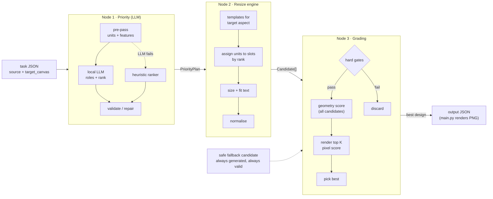

# CHAMELEON three-node pipeline: architecture

**Status:** draft for team review · 2026-10-13
**Builds on:** [Angelo's ideas](../architecture.md) (the candidate-and-score loop), reorganised around an LLM priority step.

| Doc | Covers |
|---|---|
| this file | the pipeline end to end, shared data contracts, failure policy, code layout, build changes, decisions, open questions |
| [01-priority-node.md](01-priority-node.md) | node 1: the LLM that labels and ranks elements |
| [02-resize-engine.md](02-resize-engine.md) | node 2: turning a ranking into candidate layouts |
| [03-grading-node.md](03-grading-node.md) | node 3: rejecting, scoring and picking a candidate |

---

## 1. What we're building

`engine/resize.py` receives one design (canvas + elements) and a target canvas, and must return the same elements re-laid-out for the target. We split that into three nodes that run in sequence:

1. **Priority node (LLM).** Works out what each element *is* (headline, logo, CTA, legal text...) and ranks them by how much they matter. The engine is never told this; the input only has ids, types, geometry and content.
2. **Resize engine.** Uses the ranking to build many candidate layouts for the target shape: important things get space first, minor things get whatever is left.
3. **Grading node.** Throws out candidates that break a hard rule, scores the rest on layout quality and on the rendered pixels, and returns the best one.

Why split it this way:

- The hardest *semantic* question ("which of these 17 boxes is the headline, and does the legal line matter?") goes to the component that can read text.
- The *geometry* stays in deterministic Python we can unit-test and reason about.
- Choosing between layouts becomes a measurable scoring problem instead of a single guess. We generate many and keep the best.



`engine/main.py` is unchanged: it still calls `resize(source, target_canvas)`, self-checks, writes `<task>_output.json` and renders `<task>_output.png`.

---

## 2. Constraints that shape every node

| Constraint | Where it comes from | What it forces |
|---|---|---|
| No network at run time (`docker run --network none`) | `chameleon/README.md`, FAQ Q5 | The LLM is a **local open-weights model baked into the Docker image**. No hosted API calls during stage-one scoring. |
| Image is `linux/amd64`; reference machine is an Apple M5 Pro | `Dockerfile`, `RULES.md` | Inference is **CPU-only**, very likely under amd64 emulation. A small quantised model is the realistic choice, and latency has to be measured early. |
| Fine-tuned weights must be public | `RULES.md` | If we LoRA-tune the ranker, the adapter goes on a public Hugging Face repo. |
| Same ids, none added or removed; nothing off-canvas; non-cover images keep aspect ±5% | `RULES.md`, `resize.py` docstring | Node 2 builds valid-by-construction; node 3 re-checks as hard gates. |
| `content` and `font_family` fixed; `font_size` may change | `RULES.md` | Node 2 only touches geometry, `font_size` and size-derived fields (corner radius, letter spacing). |
| Never regenerate or replace pixel content | `RULES.md` (**disqualifying**) | No generative-image step anywhere. The LLM reads metadata only; it never touches assets. |
| JSON *and* rendered PNG are both judged; the PNG by an AI judge | `RULES.md` | Node 3 must look at rendered pixels, not just boxes. |
| Must not crash, including on a missing asset | Level 3 sample, FAQ Q4 | Every node has a fallback; `resize()` always returns valid JSON. |
| Latency is not disqualifying, quality first | `RULES.md` | We can afford dozens of candidates and a handful of renders per task. |

---

## 3. Running example (Level 2: 1080×1080 → 1600×400)

The numbers below are illustrative. They show the shape of what each node produces, not measured output.

**Node 1** builds 8 units from 11 elements (the `badge` and `cta` groups each become one unit) and returns roughly:

| rank | unit | elements | role |
|---|---|---|---|
| (layer) | `bg` | bg | background |
| (layer) | `deco_circle_1`, `deco_circle_2` | ... | decoration |
| 1 | `headline` | headline | headline |
| 2 | `product` | product | hero_image |
| 3 | `cta` | cta_bg, cta_label | cta |
| 4 | `logo` | logo | logo |
| 5 | `subhead` | subhead | subheadline |
| 6 | `badge` | badge_bg, badge_label | badge |

**Node 2** sees aspect 4.0 → class `wide`, tries the wide templates (e.g. *image | text stack | CTA*, mirrored, with several margin and split settings) and returns about 20–40 candidates plus the safe fallback.

**Node 3** drops any candidate with overflowing text or an off-canvas element, scores the rest on hierarchy, overlap, spacing, alignment and faithfulness, renders the top few to check text contrast against the background, and returns the winner.

---

## 4. Shared data contracts

These live in `engine/pipeline/types.py` as dataclasses. JSON shown for readability.

### 4.1 `PriorityPlan` (node 1 → node 2, node 3)

```json
{
  "source": "llm",                       // "llm" | "heuristic"; which path produced it
  "units": [
    {
      "unit_id": "cta",                  // group_id, or the element id for singletons
      "element_ids": ["cta_bg", "cta_label"],
      "kind": "container_label",         // single | container_label | group
      "role": "cta",                     // see roles table in 01-priority-node.md
      "rank": 3,                         // 1 = most important; null for background/decoration
      "flags": []                        // e.g. ["missing_asset"], ["rotated"]
    }
  ],
  "background_unit_ids": ["bg"],
  "decoration_unit_ids": ["deco_circle_1", "deco_circle_2"]
}
```

Invariant: every source element id appears in exactly one unit. Ranks over content units are a strict order `1..n`.

### 4.2 `Candidate` (node 2 → node 3)

```json
{
  "candidate_id": "wide/img-text-cta/mirror=0/margin=0.05/split=0.45",
  "design": { "canvas": {...}, "elements": [...] },   // full schema-v0.9 design
  "meta": {
    "template": "wide/img-text-cta",
    "params": { "mirror": false, "margin": 0.05, "split": 0.45 },
    "degraded_unit_ids": ["badge"],                  // units placed below their comfortable size
    "is_fallback": false
  }
}
```

### 4.3 `GradeReport` (node 3 output, per candidate)

```json
{
  "candidate_id": "...",
  "passed_gates": true,
  "failed_gates": [],
  "metrics": { "hierarchy": 0.86, "legibility": 0.91, "overlap": 1.0, "...": "..." },
  "rendered": true,
  "total": 0.78
}
```

`resize()` returns only the chosen `design`. The ranked list of reports is kept for debugging and for the finale add-on ("pick one of the top options").

---

## 5. Orchestration and failure policy

```python
def resize(source, target_canvas):
    try:
        plan = priority.plan(source)              # never raises: LLM -> heuristic fallback inside
    except Exception:
        plan = priority.heuristic_plan(source)

    candidates = [layout.safe_fallback(source, target_canvas, plan)]   # always first, always valid
    for template in layout.templates_for(target_canvas):
        try:
            candidates += layout.generate(source, target_canvas, plan, template)
        except Exception:
            continue                              # one bad template never sinks the task

    try:
        best = grading.pick_best(source, plan, candidates)
    except Exception:
        best = candidates[0]                      # the safe fallback
    return best.design
```

The rules:

- **Never crash, never return invalid JSON.** Each layer catches its own failures and degrades to something simpler. The last resort is the safe fallback candidate (uniform scale-to-fit, centred, background cover-filled). Node 2 guarantees it passes every hard gate.
- **Deterministic.** LLM at temperature 0 with a fixed seed; templates and parameter grids enumerated in a fixed order; ties broken by `candidate_id`. The same input always gives the same output.
- **Debug output is opt-in.** With `CHAMELEON_DEBUG=1`, write the plan, every candidate's scores and a contact sheet of renders to `output/debug/<task>/`. It's off by default so the scored output folder only holds the expected files.

---

## 6. Code layout

```
chameleon/
  engine/
    main.py                  # unchanged
    resize.py                # wires the three nodes + failure policy (section 5)
    pipeline/
      types.py               # PriorityPlan, Unit, Candidate, GradeReport
      geometry.py            # boxes, rotated bounds, overlap, aspect helpers
      textmeasure.py         # wraps renderer.converter.wrap: measure / fit text exactly like the renderer
      render.py              # in-memory render via renderer.converter (no file writes)
      priority/              # node 1
        units.py             # group + implicit-group detection, background detection
        features.py          # per-unit features fed to the LLM and the heuristic
        llm.py               # llama.cpp call, JSON-schema constrained
        prompt.py            # system prompt + payload builder
        heuristic.py         # rule-based ranker (fallback)
        validate.py          # schema check, repair, reconcile with hard signals
      layout/                # node 2
        aspect.py            # aspect classes
        templates.py         # slot-tree templates per class
        assign.py            # rank -> slot assignment, clustering, overflow
        size.py              # per-slot sizing for images, text, groups
        normalize.py         # field copying, rounding, clamping
        fallback.py          # safe fallback candidate
      grading/               # node 3
        gates.py
        geometry_metrics.py
        pixel_metrics.py
        score.py             # weights, combination, top-K selection
  models/                    # GGUF weights, downloaded at docker build (gitignored)
  dev/                       # dev-only tooling, not copied into the image
    targets.json             # catalogue of real platform sizes for local testing
    run_matrix.py            # every source × every target -> contact sheet
    calibrate_grader.py      # offline judge loop (section 8)
```

Text measurement reuses the vendored renderer's own code (`renderer/converter/wrap.py` plus the brand-kit `FontManager`), so "fits" in our engine means "fits" in the official render. We import from `renderer/`; we never edit it.

---

## 7. Build and runtime changes

- **`requirements.txt`**: add `llama-cpp-python` (CPU build) and `numpy` for the pixel metrics. Pin versions.
- **`Dockerfile`**:
  - add `build-essential` + `cmake` if no prebuilt CPU wheel fits `python:3.11-slim` on amd64;
  - download the GGUF model during the build (pinned revision + SHA-256 check) into `/app/models/`;
  - add `COPY models/` only if we decide to vendor weights instead of downloading them.
- **Image size.** A 1.5B model at Q4 is roughly 1 GB and a 3B one roughly 2 GB. The main brief mentions a size limit we don't have the number for yet (open question 3).
- **Smoke test.** `docker run --network none` on the three samples must pass before every merge to `main`. Record the per-task wall time.

---

## 8. Development loop

1. **More targets than the three samples.** `dev/targets.json` lists real formats (scoring targets are "real platform formats", per RULES): Instagram post 1080×1080, portrait 1080×1350, story 1080×1920, YouTube thumbnail 1280×720, LinkedIn banner 1584×396, Facebook cover 820×312, leaderboard 728×90, medium rectangle 300×250, wide skyscraper 160×600, billboard 970×250. `dev/run_matrix.py` runs every input against every target and builds a contact sheet. This is our main way to look at results.
2. **More sources.** Hand-write a few more source designs in the schema, varying element counts, a design with no groups, and a design with no images. The hidden set will have shapes we haven't seen.
3. **Claude as a dev-time helper only. It is never in the Docker image and never called at scoring time.** We can use it to:
   - label unit roles and ranks on our dev designs, giving golden data for testing node 1 and, later, LoRA training data;
   - act as a rubric judge on rendered candidates, to calibrate node 3's weights ([03-grading-node.md §5](03-grading-node.md)).

   Use the Anthropic Python SDK, model `claude-opus-5-5`, with structured outputs (`client.messages.parse()` / `output_config.format`) so labels come back schema-valid.

---

## 9. Calls made in this draft

These are my calls, open to challenge in review:

1. **Rank units, not raw elements.** Group members (`group_id`) and implicit label-on-shape pairs are merged before the LLM sees anything, and every member inherits its unit's rank. This means fewer things to rank, fewer ways for a small model to go wrong, and groups always travel together.
2. **The ranking doesn't depend on the target.** Node 1 answers "what matters in this design"; node 2 decides how much of it fits the target. This makes the ranking cacheable per source and testable on its own.
3. **Local, text-only LLM for stage one.** A small instruct model (around 1.5–3B, Q4 GGUF, llama.cpp on CPU) gets the design as compact JSON features. Seeing the rendered source (a VLM) is an upgrade path, not the starting point.
4. **The LLM labels; code decides membership and hard facts.** It can't change which elements form a unit, and it can't override a hard signal such as "this image covers the whole canvas at the lowest z, so it's the background".
5. **Every node has a deterministic fallback**: heuristic ranker, safe fallback layout, fallback-as-winner.
6. **No model in the grading loop at run time.** Node 3 is deterministic geometry plus pixel metrics, calibrated offline against a judge. A local VLM judge stays optional (off by default) because of CPU cost under emulation.
7. **Low-priority elements are shrunk and pushed to the edges, never hidden.** No `opacity: 0`, no zero-size boxes, no burying under other elements. A hidden element would be the "dishonest JSON" RULES warns about.

## 10. Open questions

For the team or the organisers, most important first:

1. **Decorative bleed.** Level 2's `deco_circle_1` starts at (-100, -100) in the *source*. RULES says nothing may be off-canvas, but the README calls the bleed "expected". Can decorative shapes bleed off the target canvas, or must we clamp them inside? Until we hear back, node 2 clamps everything inside the canvas.
2. **Readability floor for minor elements.** In 728×90, every one of Level 3's 17 elements has to appear. Is very small legal or badge text acceptable to the judge, or should the floor be higher, with lower-ranked units taking a worse position instead of a smaller size?
3. **Docker image size limit** from the main brief. This decides 1.5B vs 3B vs a bigger model.
4. **Exact reference hardware** (cores, RAM, whether Docker runs amd64 under emulation). This decides whether LLM latency is seconds or minutes per task.
5. **Will hidden tasks reference assets outside `brand_kit/`?** It affects whether the missing-asset path is an edge case or a common one.
6. **The full scoring rubric** (main brief, Section 3). Node 3's weights should mirror its rows.
