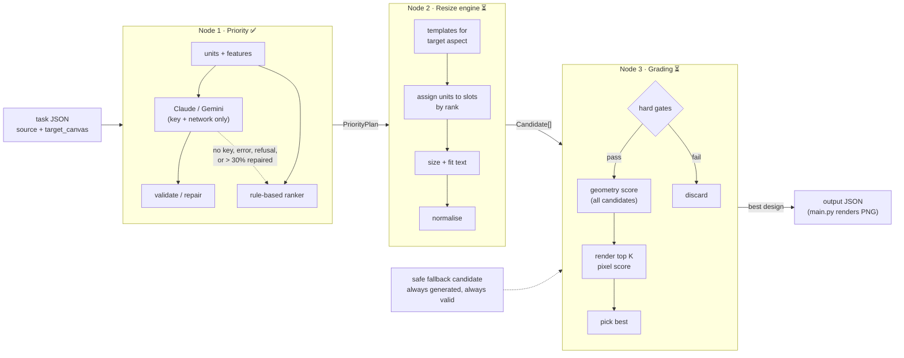

# CHAMELEON three-node pipeline: architecture

**Status (2026-10-14):** node 1 (priority) and the shared foundations are built ([PR #4](https://github.com/AngeloLandiza/Adobe-26-University-Hackathon/pull/4), plan Tasks 1–6). Nodes 2 and 3 are designed but not built yet. Until plan Task 12 connects the nodes, `engine/resize.py` still runs the starter's stretch baseline.
**Builds on:** [Angelo's ideas](../architecture.md) (the candidate-and-score loop), reorganised around a priority step.
**Implementation plan:** [stage-1 plan](../superpowers/plans/2026-10-13-stage1-three-node-pipeline.md), with per-task status.

| Doc | Covers | Built? |
|---|---|---|
| this file | the pipeline end to end, shared data contracts, failure policy, code layout, build changes, decisions, open questions | — |
| [01-priority-node.md](01-priority-node.md) | node 1: grouping elements, labelling and ranking them (LLM or rule-based) | ✅ Tasks 3–6 |
| [02-resize-engine.md](02-resize-engine.md) | node 2: turning a ranking into candidate layouts | ⏳ Tasks 7–9 |
| [03-grading-node.md](03-grading-node.md) | node 3: rejecting, scoring and picking a candidate | ⏳ Tasks 10–11 |

---

## 1. What we're building

`engine/resize.py` receives one design (canvas + elements) and a target canvas, and must return the same elements re-laid-out for the target. We split that into three nodes that run in sequence:

1. **Priority node.** Works out what each element *is* (headline, logo, CTA, legal text...) and ranks them by how much they matter. The engine is never told this; the input only has ids, types, geometry and content. A hosted LLM (Claude or Gemini) does this when an API key and network are available; otherwise a deterministic rule-based ranker does.
2. **Resize engine.** Uses the ranking to build many candidate layouts for the target shape: important things get space first, minor things get whatever is left.
3. **Grading node.** Throws out candidates that break a hard rule, scores the rest on layout quality and on the rendered pixels, and returns the best one.

Why split it this way:

- The hardest *semantic* question ("which of these 17 boxes is the headline, and does the legal line matter?") goes to the component that can read text.
- The *geometry* stays in deterministic Python we can unit-test and reason about.
- Choosing between layouts becomes a measurable scoring problem instead of a single guess. We generate many and keep the best.



`engine/main.py` is unchanged: it still calls `resize(source, target_canvas)`, self-checks, writes `<task>_output.json` and renders `<task>_output.png`.

---

## 2. Constraints that shape every node

| Constraint | Where it comes from | What it forces |
|---|---|---|
| No network at run time (`docker run --network none`) | `chameleon/README.md`, FAQ Q5 | **No hosted API calls during stage-one scoring.** The Claude/Gemini path only runs in development (and later stages, if network is allowed). In the scored Docker run, node 1 uses the rule-based ranker. If the provider benchmark shows the LLM is clearly better, the options are a local model baked into the image, or organiser permission for network access. |
| Image is `linux/amd64`; reference machine is an Apple M5 Pro | `Dockerfile`, `RULES.md` | Everything at scoring time is CPU-only, probably under amd64 emulation. This matters most if we ever ship a local model. |
| Fine-tuned weights must be public | `RULES.md` | If we LoRA-tune a ranker, the adapter goes on a public Hugging Face repo. |
| Same ids, none added or removed; nothing off-canvas; non-cover images keep aspect ±5% | `RULES.md`, `resize.py` docstring | Node 2 builds valid-by-construction; node 3 re-checks as hard gates. |
| `content` and `font_family` fixed; `font_size` may change | `RULES.md` | Node 2 only touches geometry, `font_size` and size-derived fields (corner radius, letter spacing). |
| Never regenerate or replace pixel content | `RULES.md` (**disqualifying**) | No generative-image step anywhere. The LLM reads metadata only; it never touches assets. |
| JSON *and* rendered PNG are both judged; the PNG by an AI judge | `RULES.md` | Node 3 must look at rendered pixels, not just boxes. |
| Must not crash, including on a missing asset | Level 3 sample, FAQ Q4 | Every node has a fallback; `resize()` always returns valid JSON. Node 1's `plan()` already never raises. |
| Latency is not disqualifying, quality first | `RULES.md` | We can afford dozens of candidates and a handful of renders per task. |

---

## 3. Running example (Level 2: 1080×1080 → 1600×400)

The node 1 output below is what the rule-based ranker actually produces today. The node 2 and 3 descriptions are still design intent.

**Node 1** builds 9 units from 11 elements (the `badge` and `cta` groups each become one unit):

| rank | unit | elements | role |
|---|---|---|---|
| (layer) | `bg` | bg | background |
| (layer) | `deco_circle_1`, `deco_circle_2` | ... | decoration |
| 1 | `headline` | headline | headline |
| 2 | `product` | product | hero_image |
| 3 | `cta` | cta_bg, cta_label | cta |
| 4 | `logo` | logo | logo |
| 5 | `subhead` | subhead | subheadline |
| 6 | `badge` | badge_bg, badge_label | badge |

**Node 2** sees aspect 4.0 → class `wide`, tries the wide templates (e.g. *image | text stack | CTA*, mirrored, with several margin and split settings) and returns about 20–40 candidates plus the safe fallback.

**Node 3** drops any candidate with overflowing text or an off-canvas element, scores the rest on hierarchy, overlap, spacing, alignment and faithfulness, renders the top few to check text contrast against the background, and returns the winner.

---

## 4. Shared data contracts

These are dataclasses in `chameleon/engine/pipeline/types.py` (built). JSON is shown for readability.

### 4.1 `PriorityPlan` (node 1 → node 2, node 3)

```json
{
  "source": "llm",                        // "llm" | "heuristic": which path produced the ranking
  "units": [
    {
      "unit_id": "cta",                   // group_id, the shape's id for a detected button, or the element id
      "element_ids": ["cta_bg", "cta_label"],
      "kind": "container_label",          // single | container_label | group
      "role": "cta",                      // see the roles table in 01-priority-node.md
      "rank": 3,                          // 1 = most important; null for background/decoration
      "flags": []                         // "background", "missing_asset", "rotated"
    }
  ],
  "stats": {                              // null when no LLM was asked
    "provider": "claude", "model": "claude-opus-5-5",
    "latency_s": 3.2, "input_tokens": 1900, "output_tokens": 700, "cost_usd": 0.022,
    "repaired_fraction": 0.0, "cached": false,
    "error": null                         // why the heuristic was used instead, e.g. "too_many_repairs"
  }
}
```

Helpers on the plan: `ranked_units()`, `background_unit_ids()`, `decoration_unit_ids()`, `unit_for_element(id)`, and `weight(unit_id)` = `rank ** -0.7` (0 for unranked units). Background and decoration ids are derived from roles, not stored separately.

Invariants:
- every source element id appears in exactly one unit;
- ranks over content units are a strict order `1..n`;
- units with a missing asset are ranked last.

### 4.2 `Candidate` (node 2 → node 3)

```json
{
  "candidate_id": "row/cutoff=4/margin=0.04/mirror=False/split=0.45",
  "design": { "canvas": {...}, "elements": [...] },   // full schema-v0.9 design
  "template": "row",
  "params": { "cutoff": 4, "margin": 0.04, "mirror": false, "split": 0.45 },
  "degraded_unit_ids": ["badge"],                     // units placed below their comfortable size
  "is_fallback": false
}
```

### 4.3 `GradeReport` (node 3 output, per candidate)

```json
{
  "candidate_id": "...",
  "passed_gates": true,
  "failed_gates": [],
  "metrics": { "hierarchy": 0.86, "legibility": 0.91, "overlap": 1.0, "...": "..." },
  "rendered": true,
  "total": 0.78
}
```

`resize()` returns only the chosen `design`. The ranked list of reports is kept for debugging and for the finale add-on ("pick one of the top options").

---

## 5. Orchestration and failure policy

This is the planned `resize()` (plan Task 12). Node 1's part already exists as `plan()`.

```python
def resize(source, target_canvas):
    plan = priority.plan(source)                  # never raises: LLM -> heuristic fallback inside (built)

    candidates = [layout.safe_fallback(source, target_canvas, plan)]   # always first, always valid
    try:
        candidates += layout.generate_candidates(source, target_canvas, plan, measurer)
    except Exception:
        pass                                      # a node 2 bug never sinks the task

    try:
        best, reports = grading.pick_best(source, target_canvas, plan, candidates, measurer)
    except Exception:
        best = candidates[0]                      # the safe fallback
    return best.design
```

The rules:

- **Never crash, never return invalid JSON.** Each layer catches its own failures and degrades to something simpler. The last resort is the safe fallback candidate (uniform scale-to-fit, centred, background cover-filled), which node 2 guarantees passes every hard gate.
- **Deterministic.** Templates and parameter grids are enumerated in a fixed order and ties are broken by `candidate_id`. The rule-based ranker is fully deterministic. LLM answers can vary between calls; the response cache (§8) makes repeated development runs repeatable.
- **Debug output is opt-in.** With `CHAMELEON_DEBUG=1`, the plan, every candidate's scores and a contact sheet of renders go to `output/debug/<hash of source + target>/`. It's off by default so the scored output folder only holds the expected files.

---

## 6. Code layout

✅ = built (PR #4), ⏳ = planned.

```
chameleon/
  engine/
    main.py                  # unchanged starter orchestrator
    resize.py                # ⏳ still the starter baseline; wires the three nodes in Task 12
    pipeline/
      types.py               # ✅ PriorityPlan, Unit, LLMCallStats, Candidate, GradeReport
      geometry.py            # ✅ boxes, rotated bounds, overlap, union, fit-to-aspect, in-canvas check
      textmeasure.py         # ✅ TextMeasurer: wrap, line count, block height, line widths, fits, fit_font_size
      render.py              # ✅ render_to_image(design) via the vendored renderer
      priority/              # node 1 ✅
        __init__.py          #   plan() (LLM + fallback), heuristic_plan(), _assemble()
        units.py             #   build_units(): groups, detected buttons, hard-signal flags
        features.py          #   unit_features(): what the LLM and the heuristic see
        heuristic.py         #   rule-based roles and ranking
        prompt.py            #   system prompt, user message, per-design response schema
        providers.py         #   ClaudeProvider, GeminiProvider, get_provider(), cached_complete()
        pricing.py           #   per-model token prices for cost tracking
        validate.py          #   repair() of LLM answers
      layout/                # node 2 ⏳ aspect, place, layers, normalize, fallback, templates, generate
      grading/               # node 3 ⏳ gates, metrics, pixels, score
  tests/                     # ✅ pytest suite (run from chameleon/); live API tests are opt-in
  dev/                       # dev-only tooling, not copied into the Docker image
    targets.json             # ✅ 10 real platform sizes for local testing
    golden/                  # ✅ hand-labelled roles and rankings for the 3 samples (team judgements)
    priority_metrics.py      # ✅ role accuracy, Kendall tau, top-3 recall
    run_matrix.py            # ⏳ every source × every target -> contact sheet (Task 13)
    bench_priority.py        # ⏳ Claude vs Gemini vs heuristic: cost, latency, quality (Task 14)
```

**Text measurement matches the renderer.** It reuses the vendored renderer's own wrap code and brand-kit fonts, and its height model follows cr-renderer's drawing code:
- line *i* starts at `i × font_size × line_height`;
- the last line extends to the font's full glyph height;
- the renderer doesn't clip text to its box.

A render-based test confirms text sized this way stays inside its box. We import from `renderer/`; we never edit it.

---

## 7. Build and runtime changes

- **`requirements.txt`** now adds `numpy`, `anthropic` and `google-genai<3.0.0`. They're installed at build time, like everything else, and pinned to exact versions in plan Task 15. The SDKs sit unused in the scored run (no network), but keep the image able to use the API path where network exists.
- **`requirements-dev.txt`** adds `pytest` for local development only.
- **`Dockerfile`** is unchanged. It copies `engine/`, `renderer/` and `brand_kit/`; `tests/` and `dev/` stay out of the image.
- **API keys never go in the image or in git.** They come from environment variables only, and `.env` is gitignored.
- **Smoke test** (Task 15): `docker run --network none` on the three samples must pass, and node 1 must report `source=heuristic`.
- **If we later ship a local model:** add `llama-cpp-python` and download pinned GGUF weights at build time. Image size and emulated CPU speed (open questions 3–4) decide whether that's viable.

---

## 8. Development loop

**Run the tests** from `chameleon/`:

```bash
.venv/Scripts/python -m pytest -q
```

**Environment variables:**

| Variable | Effect |
|---|---|
| `ANTHROPIC_API_KEY` / `GEMINI_API_KEY` (or `GOOGLE_API_KEY`) | enable the hosted LLM path |
| `CHAMELEON_LLM` | `auto` (default: Claude if its key is set, else Gemini, else heuristic), `claude`, `gemini` or `heuristic` |
| `CHAMELEON_CLAUDE_MODEL` / `CHAMELEON_GEMINI_MODEL` | override the default models (`claude-opus-5-5`, `gemini-3.8-flash`) |
| `CHAMELEON_LLM_CACHE` | a directory: successful LLM answers are cached there, so repeated runs don't pay again |
| `CHAMELEON_DEBUG` | `1` writes debug output (from Task 12) |

**Live API tests** are skipped by default. With keys set, run:

```bash
.venv/Scripts/python -m pytest tests/test_providers.py -m live -s
```

**The rest of the loop:**

1. **More targets than the three samples.** `dev/targets.json` lists real formats (scoring targets are "real platform formats", per RULES): Instagram post 1080×1080, portrait 1080×1350, story 1080×1920, YouTube thumbnail 1280×720, LinkedIn banner 1584×396, Facebook cover 820×312, leaderboard 728×90, medium rectangle 300×250, wide skyscraper 160×600, billboard 970×250. `dev/run_matrix.py` (Task 13) will run every input against every target and build a contact sheet. That's our main way to look at results.
2. **More sources.** Hand-write more source designs in the schema: different element counts, a design with no groups, one with no images. Give each a golden label file in `dev/golden/`. Three samples are too few to judge the LLM against the heuristic.
3. **Provider benchmark** (Task 14): Claude vs Gemini vs heuristic on the golden set, measuring cost, latency, role accuracy, Kendall τ and top-3 recall.
4. **Claude as a development helper.** Beyond being a node 1 provider, it can draft golden labels for new designs (a teammate reviews them), and act as a rubric judge to calibrate node 3's weights ([03-grading-node.md §5](03-grading-node.md)).

---

## 9. Decisions

**Design calls** (from the first draft, still standing):

1. **Rank units, not raw elements.** Group members and detected label-on-shape buttons are merged before ranking, and every member inherits its unit's rank.
2. **The ranking doesn't depend on the target.** Node 1 answers "what matters in this design"; node 2 decides how much of it fits.
3. **The LLM labels; code decides membership and hard facts.** Which elements form a unit, which unit is the background, and missing assets are all decided by code.
4. **Every node has a deterministic fallback:** rule-based ranker, safe fallback layout, fallback-as-winner.
5. **No model in the grading loop at run time.** Node 3 is deterministic geometry plus pixel metrics, calibrated offline.
6. **Low-priority elements are shrunk and pushed to the edges, never hidden.** No `opacity: 0`, no zero-size boxes, nothing fully covered.

**Changed since the first draft:**

7. **Hosted LLMs first, local model later (maybe).** The team is comparing an API LLM against a local one on cost and quality, so node 1 calls Claude or Gemini in development. The scored run uses the heuristic, because there's no network there. A local model is only built if the benchmark shows the LLM is worth it.

**Decided during implementation** (details in the node docs and the plan's execution status):

8. **Text height follows cr-renderer, not `lines × size × line_height`.** The naive model under-measures by about 0.1–0.2 × font size, and a real render showed overflow.
9. **Text fits are checked on drawn line widths, including letter spacing.** The renderer draws letter spacing, but the converter's wrap ignores it.
10. **Detected buttons need exactly one text covering ≥ 25% of the shape,** so a backdrop panel behind copy isn't mistaken for a button.
11. **Background is a code decision only.** The LLM can't label a unit "background", because node 2 stretches background units over the whole canvas.
12. **LLM output that needed > 30% repairs is discarded** in favour of the heuristic. `stats.error` records why.

---

## 10. Open questions

For the team or the organisers, most important first:

0. **Is network access available during stage-one scoring?** Could the engine call an external LLM API with our key? This decides whether the API path can ever count in stage 1.
1. **Decorative bleed.** Level 2's `deco_circle_1` starts at (-100, -100) in the *source*. RULES says nothing may be off-canvas, but the README calls the bleed "expected". Can decorative shapes bleed off the target canvas, or must we clamp them inside? Until we hear back, node 2 clamps everything inside the canvas.
2. **Readability floor for minor elements.** In 728×90, every one of Level 3's 17 elements has to appear. Is very small legal or badge text acceptable to the judge, or should the floor be higher, with lower-ranked units taking a worse position instead of a smaller size?
3. **Docker image size limit** from the main brief. Only matters if we ship a local model.
4. **Exact reference hardware** (cores, RAM, whether Docker runs amd64 under emulation). This decides local-model latency.
5. **Will hidden tasks reference assets outside `brand_kit/`?** It affects whether the missing-asset path is an edge case or a common one.
6. **The full scoring rubric** (main brief, Section 3). Node 3's weights should mirror its rows.
